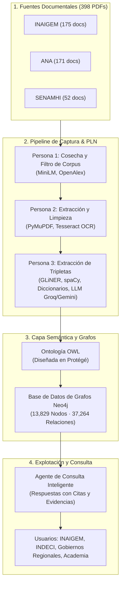

# 🏔️ Enterprise Brain Glaciares
### *Conocimiento conectado para anticipar el riesgo glaciar en el Perú*

<p align="center">
  
  
  
  
  
</p>

---

## 📌 Visión del Proyecto

El **68 % de los glaciares tropicales del mundo se encuentra en el Perú**, y en las últimas seis décadas se ha perdido más del **56 % de su superficie glaciar**. Este retroceso acelerado ha incrementado la formación de lagunas glaciares (más de 8,466 inventariadas en 20 cordilleras según el INAIGEM), de las cuales **528 presentan riesgo de desborde violento (GLOFs - Glacial Lake Outburst Floods)** y **58 ostentan riesgo muy alto**.

**Enterprise Brain Glaciares** es una plataforma basada en **Grafos de Conocimiento, Ontologías OWL e Inteligencia Artificial (PLN + LLMs)** diseñada para unificar, conectar y consultar información técnica e histórica que hoy en día se encuentra dispersa entre múltiples entidades del Estado peruano (INAIGEM, ANA, SENAMHI).

El sistema permite responder consultas complejas con **trazabilidad completa y evidencia documental** (citando documento y número de página), asistiendo la toma de decisiones para la prevención de desastres y gestión del riesgo hídrico.

---

## 📊 Métricas Clave del Proyecto

| Indicador | Cifra | Detalle |
| :--- | :---: | :--- |
| **Documentos procesados** | **398** | Publicaciones técnicas (1964–2026) de INAIGEM (175), ANA (171) y SENAMHI (52) |
| **Páginas analizadas** | **19,452** | Incluye 180 documentos reparados con OCR y 4,195 tablas extraídas |
| **Nodos en Neo4j** | **13,829** | Entidades geográficas, territoriales, eventos, mediciones y obras |
| **Relaciones en Neo4j** | **37,264** | Conexiones semánticas bidireccionales validadas |
| **Entidades únicas extraídas** | **11,343** | Lagunas, glaciares, cuencas, poblados, instituciones, etc. |
| **Hechos extraídos** | **13,256** | Tripletas de conocimiento con cita textual de soporte |
| **Hechos verificados por 2+ fuentes** | **2,502** | Validación cruzada interdocumental |
| **Preguntas de competencia** | **10 / 10** | Respondidas con cita documental exacta |

---

## 🏗️ Arquitectura General



---

## 🧠 Pipeline de Procesamiento (PLN)

El flujo de procesamiento documental se organiza en tres fases modulares:

1. **Persona 1 — Cosecha y Filtrado de Corpus:**
   - Búsqueda sistemática en repositorios de INAIGEM, ANA y SENAMHI.
   - Filtrado semántico asistido con embeddings (`MiniLM multilingüe`) y revisión manual sobre 676 candidatos para consolidar 398 documentos relevantes.
2. **Persona 2 — Normalización y Extracción de Texto:**
   - Limpieza estructural eliminando encabezados, pies de página e índices.
   - Conversión a texto enriquecido preservando referencias de sección, número de página y extracción de más de 4,195 tablas.
   - Recuperación de documentos históricos escaneados mediante **Tesseract OCR (Español)** y **PyMuPDF**.
3. **Persona 3 — Extracción y Consenso de Hechos (Tripletas):**
   - Sistema de votación multipartita para extracción de entidades y relaciones usando:
     - Reglas heurísticas y patrones lingüísticos
     - Diccionarios toponímicos e hidrológicos
     - Modelos de extracción de entidades nominales (**GLiNER** y **spaCy**)
     - LLMs (**Gemini**, **Groq**) bajo restricción estricta de verificación de evidencia textual (*grounding*).

---

## 🏛️ Modelado Ontológico (OWL & Protégé)

La semántica del dominio se modeló formalmente en **Protégé** bajo el estándar **OWL**, garantizando jerarquías disjuntas y relaciones inversas:

* **Categoría Madre (`Feature`):**
  * **Rasgo Geográfico:**
    * *Masa de hielo:* `Glaciar`, `Nevado`
    * *Cuerpo de agua:* `Laguna`, `Bofedal`, `Río`
    * *Unidad hidrográfica:* `Cuenca`, `Subcuenca`, `Quebrada`
    * *Relieve:* `Cordillera`
  * **Unidad Territorial (Disjunta de Rasgo Geográfico):**
    * `Departamento`, `Provincia`, `Distrito`, `Centro Poblado`
  * **Entidades complementarias:** `Evento` (aluvión, avalancha), `NivelRiesgo`, `ObraSeguridad`, `Institucion`, `Medicion`.
* **Propiedades de Objeto Bidireccionales:**
  * `Laguna` — **`amenaza a`** ➔ `Centro Poblado` *(Inversa: `es amenazado por`)*
  * `Laguna` — **`drena hacia`** ➔ `Subcuenca` / `Río`
  * `Laguna` — **`abastece a`** ➔ `Unidad Territorial` *(Inversa: `es abastecido por`)*
  * `Evento` — **`afectó a`** ➔ `Centro Poblado` *(Inversa: `fue afectado por`)*

---

## 🕸️ Grafo de Conocimiento en Neo4j

El grafo permite ejecutar consultas complejas mediante **Cypher** para la gestión de riesgos:

```cypher
// Ejemplo: Identificar poblados aguas abajo amenazados por lagunas de riesgo muy alto
MATCH (l:Laguna)-[:TIENE_NIVEL_RIESGO]->(r:NivelRiesgo {nombre: 'Muy Alto'})
MATCH (l)-[:AMENAZA_A]->(cp:CentroPoblado)
OPTIONAL MATCH (l)-[:TIENE_OBRA_SEGURIDAD]->(o:ObraSeguridad)
RETURN l.nombre AS Laguna, cp.nombre AS PobladoAmenazado, o.tipo AS ObrasMitigacion
ORDER BY l.nombre;
```

---

## 📁 Estructura del Repositorio

```bash
BrainGlaciares/
├── data/
│   ├── persona1/            # Metadatos del corpus seleccionado y cosechado
│   ├── persona2/            # Fragmentos limpios de texto, tablas y salidas OCR
│   └── persona3/            # Tripletas y grafos de conocimiento generados
├── ontology/
│   ├── brain_glaciares.owl  # Ontología formal en OWL construida en Protégé
│   └── docs/                # Diccionario de clases, propiedades y axiomas
├── notebooks/
│   ├── persona1_corpus.ipynb
│   ├── persona2_ocr_text.ipynb
│   └── persona3_tripletas.ipynb
├── neo4j/
│   ├── import/              # Scripts de carga y transformaciones Cypher
│   └── queries/             # Consultas y preguntas de competencia
├── docs/                    # Presentaciones, diapositivas y arquitectura técnica
└── README.md
```

---

## 🚀 Instalación y Despliegue Rápido

### Prerrequisitos
- Python 3.10 o superior
- Instancia de **Neo4j** (Desktop o Docker)
- **Protégé 5.x** (para visualización/edición de la ontología)
- Tesseract OCR (`tesseract-ocr-spa`)

### 1. Clonar el repositorio
```bash
git clone https://github.com/EdsonPerez7/BrainGlaciares.git
cd BrainGlaciares
```

### 2. Entorno virtual
```bash
python -m venv venv
source venv/bin/activate  # En Windows: venv\Scripts\activate
pip install -r requirements.txt
```

### 3. Configuración de Neo4j
Configure sus variables de entorno en un archivo `.env`:
```env
NEO4J_URI=bolt://localhost:7687
NEO4J_USER=neo4j
NEO4J_PASSWORD=tu_contraseña
```

---

## 👥 Equipo de Trabajo — Grupo G8

**Universidad Nacional Mayor de San Marcos**  
*Facultad de Ingeniería de Sistemas e Informática*

* **Frey Edson Perez Rojas**
* **Carolhay Ttito Carhuas**
* **Alexander Fabian Chamorro Ramirez**
* **Angel Fabián Marín Yachachin**
* **Luis Ernesto Mendoza Aymara**

---

## 🤝 Entidades Vinculadas y Contexto de Impacto

* **INAIGEM** (*Instituto Nacional de Investigación en Glaciares y Ecosistemas de Montaña*) — Principal organización de referencia técnica.
* **ANA** (*Autoridad Nacional del Agua*)
* **SENAMHI** (*Servicio Nacional de Meteorología e Hidrología del Perú*)
* **Propuesta PROCIENCIA:** Proyecto concebido para escalar de madurez tecnológica de **TRL 4 a TRL 6**.

---

## 📄 Declaración de Uso de IA
En cumplimiento de las buenas prácticas académicas y de reproducibilidad, este proyecto declara el uso de modelos de lenguaje (LLMs como Gemini y Groq) e IA generativa en tareas específicas de extracción de relaciones y procesamiento lingüístico, operando bajo validación cruzada y verificación de evidencia directa (*grounding* contra los textos originales).
